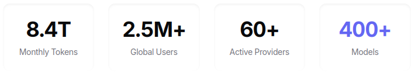
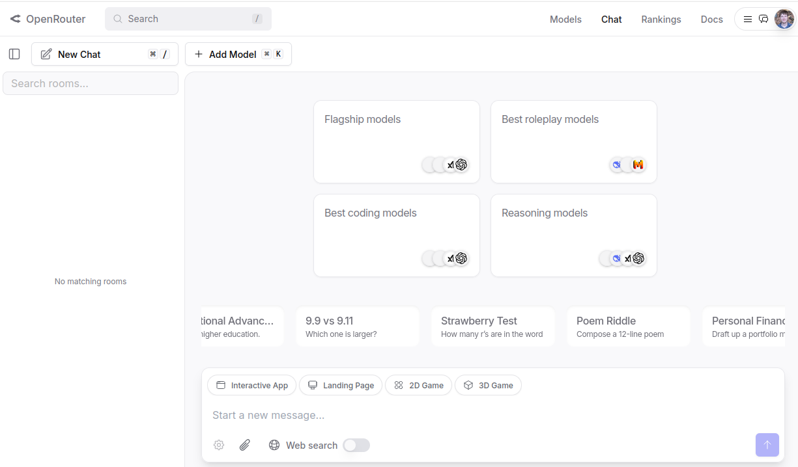
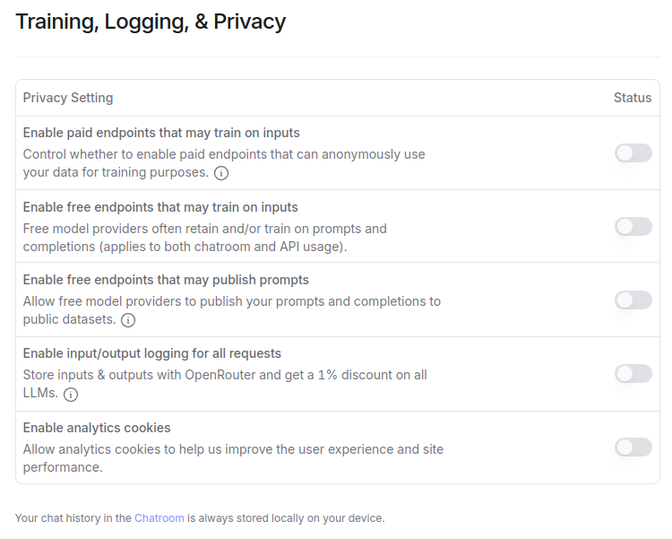

# An Introduction to OpenRouter




-------------------

As displayed in The Oracle's kitchen in The Matrix:

"Temet Nosce," Latin for "Know Thyself" .. or in this case, know what we're selling.

--------------------

Unless you have a rack of NVIDIA H100s in your basement, chances are good you may not have tried Moonshot Ai's Kimi-K2-Instruct, what with it being a 1-Trillion (with a T!) parameter language model that would roughly need over 1TB (again.. a T) of VRAM just to load weights at fp8 precision. Luckily for us both, LLM inference providers exist and will happily sell you tokens from Kimi-K2 at just $2.50 per *Million* tokens generated. But, there are lots of providers, with different interfaces, signups, accounts, Terms, and they don't all host every new model you might want to try.

Enter OpenRouter.ai - the one-stop-shop vendor of vendors. For a 5.5% surcharge at 'credits' purchase, OpenRouter will wrap all the other providers up into a simple interface so you set up one account, one billing, one use tracking, and one API.

For the casual user - https://openrouter.ai/chat is a ChatGPT-like direct portal to all sorts of models and providers:



It stores conversations across sessions (on your machine), allows you to toggle settings, and most importantly choose what model you want to run in order to get a quick familiarity with what the particular model can do. Some models are even provided for free!... just don't put anything in those you mind everyone knowing, because those providers will train on those inputs. Even with \\$0.00 in your account, you can use these (Free) providers at 50 requests per day. With \\$10.00 sitting around untouched that free limit goes up to 1000 per day. More than enough for casual curiosity and getting a sense of different things.

### What Models are Worth Trying?

Well for starters, try the big name proprietary models you haven't yet (note some proprietary models require keys from the original vendors)
- Google Gemini 2.5
- Anthropic Claude Sonnet 4
- OpenAI GPT-5

Why? Because they're SoTA edge of what's out there and if any customer has tried something, that's likely what they'll have in mind - they may not use it to its fullest, but that will be their point of reference.

Next, take a look at https://openrouter.ai/rankings - yes, this is a popularity contest by tokens, not a metric, but it can give you insights into what others are using; and they let you filter by category - programming, marketing, health, whatever suits. Find a few names you don't recognize and give them a whirl.

Finally, be sure to check the latest state of recommended models, per category, in the Awesome-Vor repo [Link](models_list.md).

### A Final Note About Privacy and Data Use

https://openrouter.ai/docs/faq#privacy-and-data-logging - OpenRouter itself does not directly log your interactions beyond the metadata around that fact that they happened. With that said, however, they are a vendor of vendors - and each individual shop has its own ToS and Policies. In your account settings be sure to toggle off any specifics you don't want in ['Training, Logging, & Privacy'](https://openrouter.ai/settings/privacy)

 

As well, the basic [preferences](https://openrouter.ai/settings/preferences) allows you to 
created 'Allowed' and 'Ignored' lists by provider. (You may want to verify that this holds for the Chat interface, I've only personally validated it for API requests).

--------

### For the Tech Folks

If you're not building and don't want to deal with code-based API calls.. thanks for coming to my TED talk, you can go grab refreshments.

For those coding:

#### Basic Requests

The easiest way to interact with the resources directly is likely an 'OpenAI Compliant' SDK with the 'base_url' set to "https://openrouter.ai/api/v1" and the model name is typically pulled from the model 'id' (e.g. clipboard icons at https://openrouter.ai/models or at the top of an individual model page, like https://openrouter.ai/openai/gpt-oss-20b). 

As an abbreviated example, stolen from a recent demo I built, using [pydantic-ai's OpenAI model](https://ai.pydantic.dev/models/openai/):

```python
from pydantic_ai.models.openai import OpenAIModel
from pydantic_ai.providers.openai import OpenAIProvider
from pydantic_ai import Agent

models.llm = OpenAIModel(
    self._settings.llm_model_name,
    provider=OpenAIProvider(
        base_url=self._settings.llm_api_base_url,
        api_key=self._settings.llm_api_key,
    ),
)

link_selector_agent = Agent(
        model=models.llm,
        output_type=SelectedLink, #typed dict
        retries=3,
        system_prompt="Given a prompt and a list of web search contents, choose the most relevant link that will help answer the user's original prompt.",
    )
    
prompt = 'Some user input'
response = await agent.run(prompt)
```

#### Pydantic-AI

An important note here, is that the default `Agent()` in pydantic-ai wants a structured response in the form of a [tool call](https://openrouter.ai/docs/features/tool-calling). This is a blessing and a curse because it helps enforce what you actually wanted/expected back in agentic patterns, instead of "please ONLY return JSON.. I pray!", but it also means the models need to support it.  As well, the providers need to support it.  You can build around this with [direct model requests](https://ai.pydantic.dev/direct/) in pydantic-ai, but there goes half the fun of the framework in the first place. There's also [structured-outputs](https://openrouter.ai/docs/features/structured-outputs) on openrouter's side, but I've only personally used tool-calling with pydantic.

#### A Couple Final Notes

In addition to the account-wide allow/ignore, openrouter provides a [routing configuration](https://openrouter.ai/docs/features/provider-routing) that you can stuff into the individual POST requests' json object. This lets you tailor individual provider settings as well as adjust the routing happens - by default they set 'Price-Based Load Balancing' and you'll want to read up there on what that means. Definitely not a standard feature of "OpenAI compliant," but hopefully whatever framework you have doesn't make it a hassle.

You will likely hit rate-limits, wrap everything in polite retries/tenacity/etc - these seem to be a shared pool that everybody hitting a given provider+model shares because they're going through openrouter. I've never seen more than a few seconds of timeout from my own experiences. You are allowed to BYOK (bring your own key) to give you your own rate limit to that provider (and you bill direct to the provider), you just pay an additional 5% to openrouter on top of whatever the provider charges you for the use of the routing service.